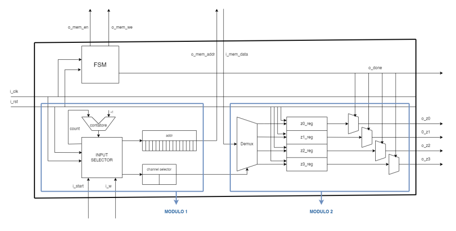
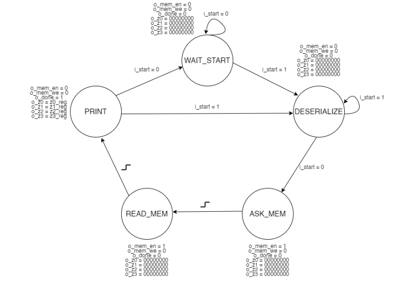

# Logic Networks Final Project (A.Y. 2022/2023)

Final project of the **Logic Networks (Reti Logiche)** course at Politecnico di Milano (Profs. Fornaciari, Palermo and Salice): a hardware module described in **VHDL** that reads a value from a memory and routes it to one of four output channels.

## Description

The component receives, on a 1-bit serial input (`i_w`) while `i_start = 1`, a sequence made of:

1. **2 header bits**: they select the output channel (`00` → `Z0`, `01` → `Z1`, `10` → `Z2`, `11` → `Z3`);
2. **up to 16 address bits** of the memory (if fewer than 16 bits are received, the address is zero-extended on the most significant bits).

When `i_start` goes back to `0`, the module reads from memory the byte stored at the received address and writes it to the selected channel, raising `o_done` for **exactly one clock cycle**. The outputs are meaningful only when `o_done = 1`, otherwise they are `0`; the channels that are not selected keep their last transmitted value (shown at the next `DONE`).

### Interface

```vhdl
entity project_reti_logiche is
    port (
        i_clk      : in  std_logic;
        i_rst      : in  std_logic;
        i_start    : in  std_logic;
        i_w        : in  std_logic;

        o_z0       : out std_logic_vector(7 downto 0);
        o_z1       : out std_logic_vector(7 downto 0);
        o_z2       : out std_logic_vector(7 downto 0);
        o_z3       : out std_logic_vector(7 downto 0);
        o_done     : out std_logic;

        o_mem_addr : out std_logic_vector(15 downto 0);
        i_mem_data : in  std_logic_vector(7 downto 0);
        o_mem_we   : out std_logic;
        o_mem_en   : out std_logic
    );
end project_reti_logiche;
```

## Architecture

The design is made of two synchronous modules coordinated by a finite state machine.



### Finite State Machine

A 5-state FSM, implemented with two processes (state transitions and outputs):

| State | Purpose |
|---|---|
| `WAIT_START` | Idle state, waits for `i_start = 1` |
| `DESERIALIZE` | Module 1 acquires `i_w`; the state is left when `i_start` goes back to `0` |
| `ASK_MEM` | `o_mem_en = 1`: requests access to the memory |
| `READ_MEM` | `o_mem_we = 0`: the data is read from the memory |
| `PRINT` | `o_done = 1` and the `zN_reg` registers are driven onto the outputs |



### Module 1 – `input_selector`

A counter dispatches the bits of `i_w` into two shift registers: `channel_selector` (2 bits, header) and `addr` (16 bits, address). Using shift registers automatically zero-extends the most significant bits when the address is shorter than 16 bits.

### Module 2 – `demux`

Routes the data read from memory (`i_mem_data`) into the register (`z0_reg` … `z3_reg`) selected by `channel_selector`. The role of the multiplexers controlled by `o_done` shown in the diagram is implemented directly by the FSM in the `PRINT` state, which saves the logic gates needed to build them.

## Synthesis results

Synthesized with **Vivado 2022.2** on part `xc7z030sbv485-1`:

| Resource | Usage |
|---|---|
| Slice LUTs | 39 |
| Flip-Flops | 85 |
| Latches | **0** |

Synthesis completed with 0 errors and 0 critical warnings.

## Repository structure

```
.
├── progetto_reti_logiche_2023.xpr    # Vivado project file
├── progetto_reti_logiche_2023.srcs/  # VHDL sources, testbenches, constraints
├── docs/
│   ├── architecture.png              # architecture diagram
│   └── fsm.png                       # FSM state diagram
├── .gitignore
└── README.md
```

The `.cache`, `.hw`, `.ip_user_files`, `.runs` and `.sims` folders are generated by Vivado and are not versioned.

## How to open the project

1. Install **Vivado** (developed with 2022.2; other versions may ask to upgrade the project).
2. Clone the repository: `git clone <repository-url>`
3. In Vivado: **File → Project → Open** and select `progetto_reti_logiche_2023.xpr`.
4. To simulate: **Flow Navigator → Run Simulation → Run Behavioral Simulation**.
5. To synthesize: **Run Synthesis**.

> Note: the RAM is instantiated inside the testbench and must not be synthesized.

## Testing

Custom testbenches were written to verify, among others, the following cases:

- basic read/write on a single channel;
- reset before or during the execution;
- repeated accesses to the same address and consecutive updates of the same register;
- boundary addresses `0` and `65535` (`i_start` lasting 2 and 18 clock cycles).

## Author

Carlo Dell'Orco — Politecnico di Milano, A.Y. 2022/2023
